# Smart Study

**One Anki extension for your whole study workflow: study plans up to your exam, plus a full workspace with notebook, PDF viewer, mind maps, focus timer, music, AI assistant and motivation, all inside Anki.**

You tell Smart Study what you have to learn (book pages, videos, lists of tasks, Anki decks), when the exam is and how much time you have each day. It spreads everything over the days until the exam, topic by topic: first read, then watch the lecture, then do the cards. Anki items tick themselves off while you study. If you fall behind, one click replans the rest. Around that, Smart Study turns Anki into a workspace so you don't have to leave it.

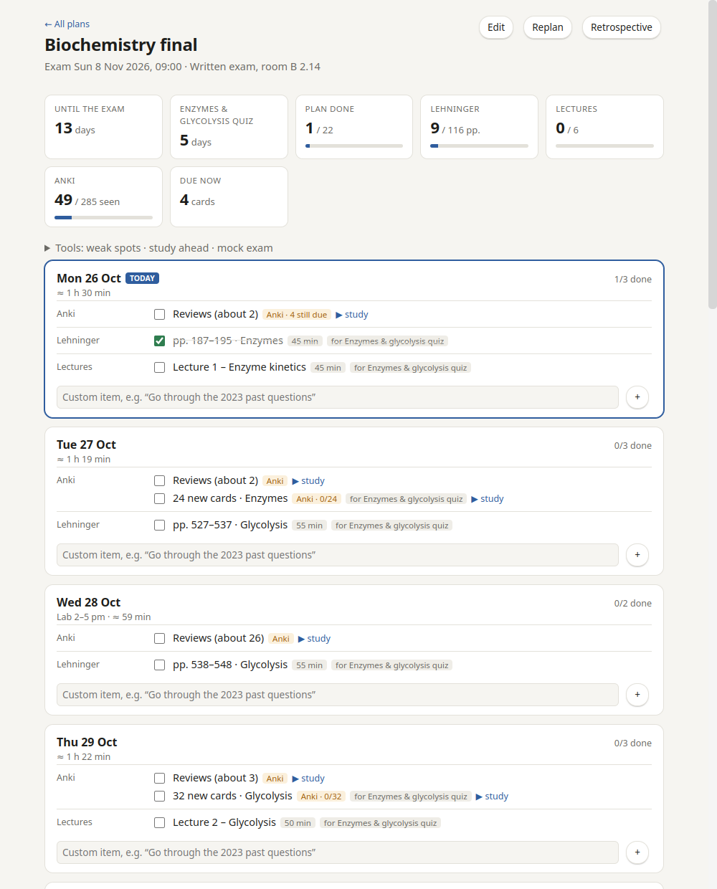

*An Anki add-on for Anki Desktop. No account. Nothing is sent anywhere unless you use an online feature yourself (see [Privacy](#privacy)).*

## What's new in 2.3

- **Same add-ons on all your devices**: Smart Study asks once whether to sync your AnkiWeb add-ons; other devices then offer to install what is missing
- **Install add-ons by code** under *Settings → Add-ons*
- **New color Orange** and the **Orange Pixel Wallpaper** example background
- The leftover "Study Plan" decks from early versions are now called **Smart Study system data**

## What's new in 2.2

- **Settings sync between your devices**: Smart Study's settings and the switches for the built-in add-ons are kept in the Anki collection, so your normal AnkiWeb sync takes them to your other computers (like the study plans). Of two copies, the newer one wins
- **Built-in add-ons in the settings**: a new **Add-ons** page in the Smart Study settings switches each built-in add-on on or off at any time
- **Progress bar removed**: the built-in progress bar is gone. If you want it back, install [Progress bar](https://ankiweb.net/shared/info/1708250053) from AnkiWeb

## What's new in 2.1

- **Built-in add-ons**: copy selections with pictures as an image, review heatmap, controller support and Life Drain come with Smart Study. Switch each one on or off under *Tools → Smart Study → Built-in add-ons…* (see [Built-in add-ons](#built-in-add-ons))
- **Already installed one of them?** Smart Study asks once whether to keep yours or use the built-in one, and takes over your settings
- **AI assistant with your own account**: ChatGPT, Claude and Gemini as tabs next to the API chat – no API key needed
- **Streaming**: YouTube Music in a sidebar; Spotify opens in its app
- **"What's new" after updates**, with a switch next to everything that was switched on
- **Fix**: searching in the website sidebar no longer crashes Anki

| Built-in add-ons | After an update |
|---|---|
| 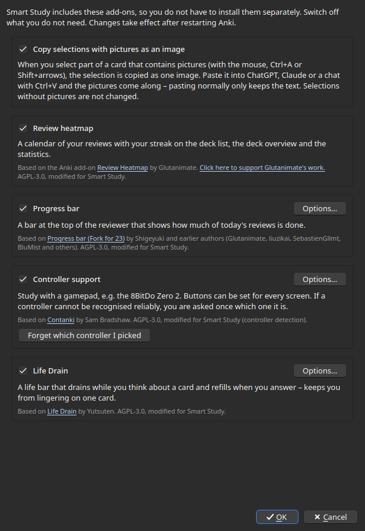 | 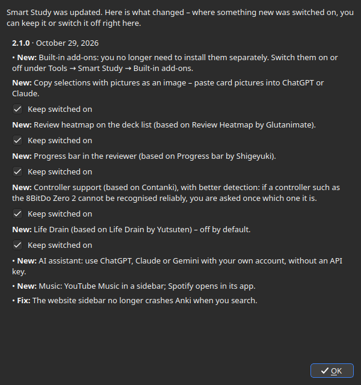 |

## What's new in 2.0

Smart Study 2.0 turns the study planner into **one** complete Anki extension:

- **One add-on, one name.** One menu (*Tools → Smart Study*), one settings window, one `.ankiaddon` file
- **A full workspace around your plan**: notebook with PDF viewer, mind maps, focus timer, music, AI assistant, website sidebar, gamification, statistics and deadlines (see [Features](#features))
- **The planner is the study plan.** *Tools → Smart Study → Study Plan…* and the **Study Plan** link in the top bar open it; there is no second, simpler plan any more
- **Private by design.** No analytics, no remotely loaded banners or content, no update pings. The website sidebar starts on DuckDuckGo
- **No Terms gate.** The first-run setup only asks for language, study area and color theme
- **New look.** New logo, icons, rank badges, achievements, music covers and wallpapers, plus synthesized focus sounds and timer chimes, all made for Smart Study (`tools/make_assets.py` generates them)
- **The launcher no longer covers Anki.** The left icon bar starts below Anki's top toolbar

Full list: [CHANGELOG.md](CHANGELOG.md).

## Features

### Study plan

**Planning**
- **Sources**: books, scripts or slides (page ranges), videos and lectures (with duration and link), any list (online modules, past questions, exercises) and **Anki decks**
- **Topics** bundle what belongs together: pages + subdeck or tag + videos. Create them from a **pasted table of contents** or from **subdecks**, then let **"Suggest links automatically"** match subdecks, tags and videos to topics by name
- **Smart scheduler**: works through the topics in order, respects your study time per day, days off and single-day exceptions, the daily new-card limit and the reviews Anki will throw at you (from its real forecast, plus the new cards coming back)
- **Milestones** (partial tests, quizzes) get their material done first. **Lab sessions** are soft milestones: read and watch before, cards continue afterwards
- **Reserve days** before the exam: weak spots round → mock exam → light review
- **Several plans at once**, optionally sharing one daily time budget (`"budget": {"minutesPerDay": 360}` in `plan/user_files/profile.json`): the nearest exam gets scheduled first, later ones get what's left
- **Replan** moves everything still open (and your own custom items) onto the remaining days. Finished items stay where they were

**While studying**
- **Auto checkmarks**: card and review items are checked off from your Anki activity, everything else with a click
- **▶ study** opens the item's own deck. No filtered decks are created, so your cards always stay in their normal decks. **📖 open** opens the PDF at the right page (Okular/Evince)
- **Weak spots round**: finds the topics with the most mistakes and schedules the pages, video and weak cards for them again
- **Weak cards** open in Anki's browser with a search, nothing gets moved
- **Mock exam** runs in the plan window: random studied cards against the clock, show the answer, mark it right or wrong, with a per-topic result

**Afterwards**
- **Retrospective**: planned vs. done, on time vs. late, per source, time spent in Anki and your measured pace, which becomes the default for your next plan
- **Maintenance mode**: keeps the decks running without new cards and with capped reviews (restores your old deck options when switched off)
- **Archive** and **next plan** in one click, plus a **study streak** and a **6-month heatmap** on the overview
- Plans **sync between devices** through your Anki collection (AnkiWeb sync)

### Workspace

- **Launcher bar** on the left with keyboard shortcuts for every tool
- **Notebook** with nested pages, task lists and a built-in **PDF viewer** (PDF.js bundled, nothing loaded from a CDN), plus a PDF card creator for basic, reversed and cloze cards
- **Mind maps** and FreeMap diagrams with images, icons and links to Anki cards
- **Pomodoro and session timers** with study-time analytics by deck
- **Music player** for local audio, optional SoundCloud, plus a Streaming sidebar with YouTube Music (Spotify opens in its app)
- **AI assistant** (optional): ChatGPT, Claude or Gemini with your own account, or an API key for OpenAI, Gemini, Anthropic, OpenRouter, DeepSeek, or local Ollama / llama.cpp. Requests go directly to the provider you choose, keys stay in your Anki profile
- **Website sidebar** for your own study sites
- **Motivation**: XP, ranks, streaks, daily challenges, celebrations
- **Dashboard**: statistics, deadlines and countdowns, daily facts, custom deck overview
- Light and dark mode, color themes, custom backgrounds, ten interface languages

### Built-in add-ons

| Add-on | What it does | Default |
|---|---|---|
| **Copy selections with pictures as an image** | Select part of a card with pictures (mouse, Ctrl+A, Shift+arrows): it is copied as one image, so ChatGPT, Claude or a chat get the pictures when you paste. Text-only selections are not touched | on |
| **Review heatmap** | Calendar of your reviews and your streak on the deck list, deck overview and statistics | on |
| **Controller support** | Study with a gamepad such as the 8BitDo Zero 2; buttons for every screen. If a controller cannot be recognised reliably (e.g. any X-Input pad on Windows), you are asked once which one it is | on |
| **Life Drain** | A life bar that drains while you think and refills when you answer | off |

Switch them on or off under *Tools → Smart Study → Settings → Add-ons* or *Tools → Smart Study → Built-in add-ons…*. Changes take effect after restarting Anki, and the switches sync to your other devices with AnkiWeb. Settings are kept in `user_files/integrations/` (the heatmap and Life Drain also in the collection, like the originals), so updates do not reset them.

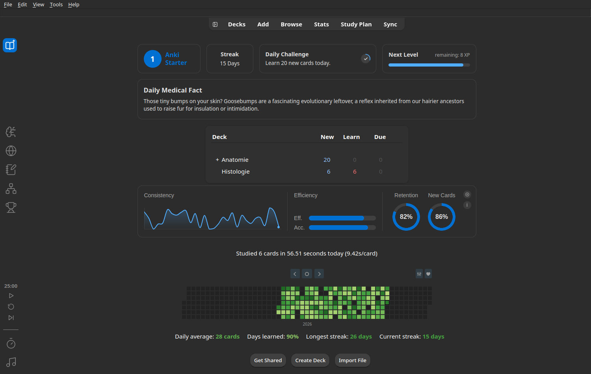

| AI assistant with your own ChatGPT/Claude/Gemini account | Controller that cannot be told apart |
|---|---|
| 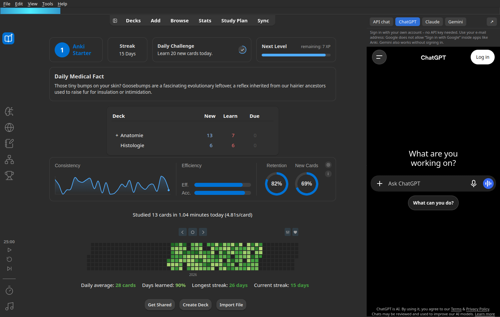 | 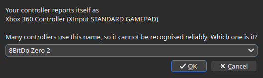 |

**Good to know**
- Google does not allow signing in inside apps such as Anki (“This browser or app may not be secure”). Sign in to ChatGPT and Claude with your e-mail address; Gemini and YouTube Music also work without signing in.
- Spotify's web player needs the Widevine copy protection, which Anki's built-in browser does not include, so Spotify plays in its own app or your normal browser.

## Screenshots

| Overview: streak, heatmap, plans | Dark mode |
|---|---|
| 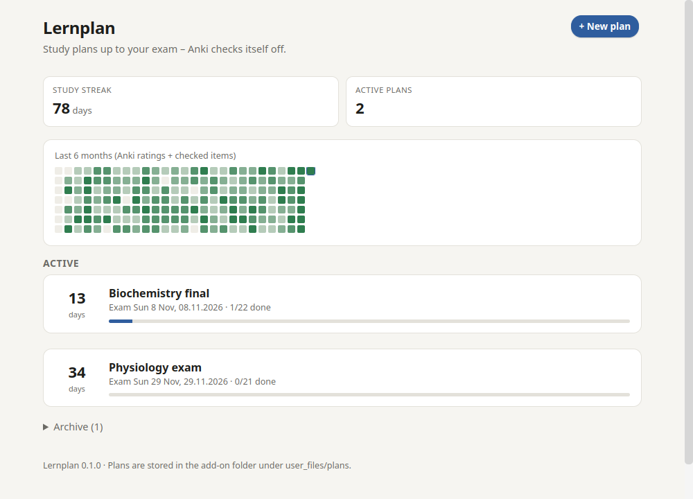 | 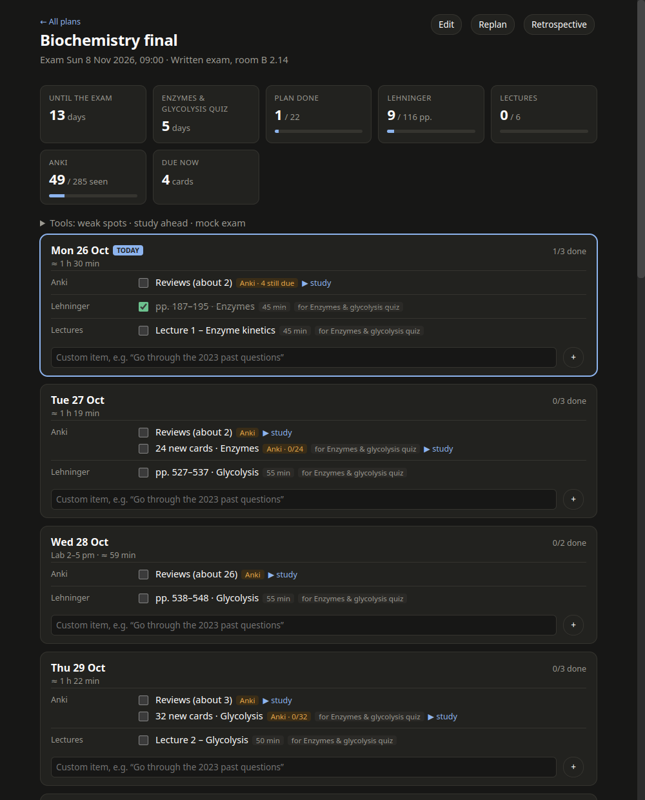 |

| Basics, milestones and single days | Sources |
|---|---|
| 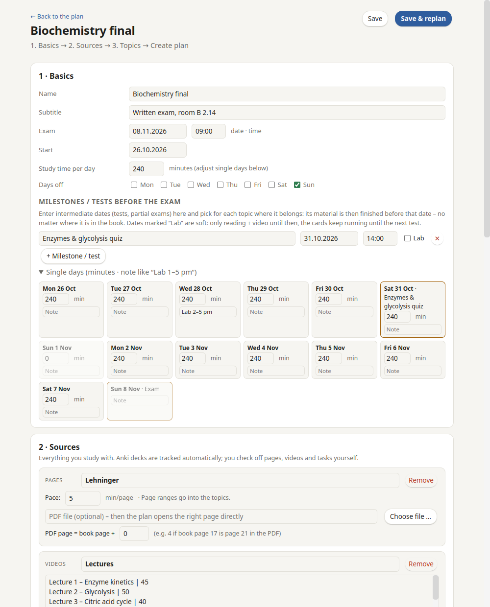 | 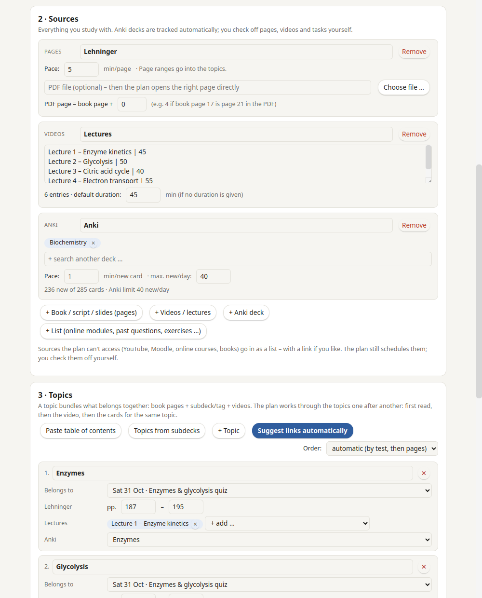 |

| Topics with linked pages, lectures and subdecks | Tools: weak spots, study ahead, mock exam |
|---|---|
| 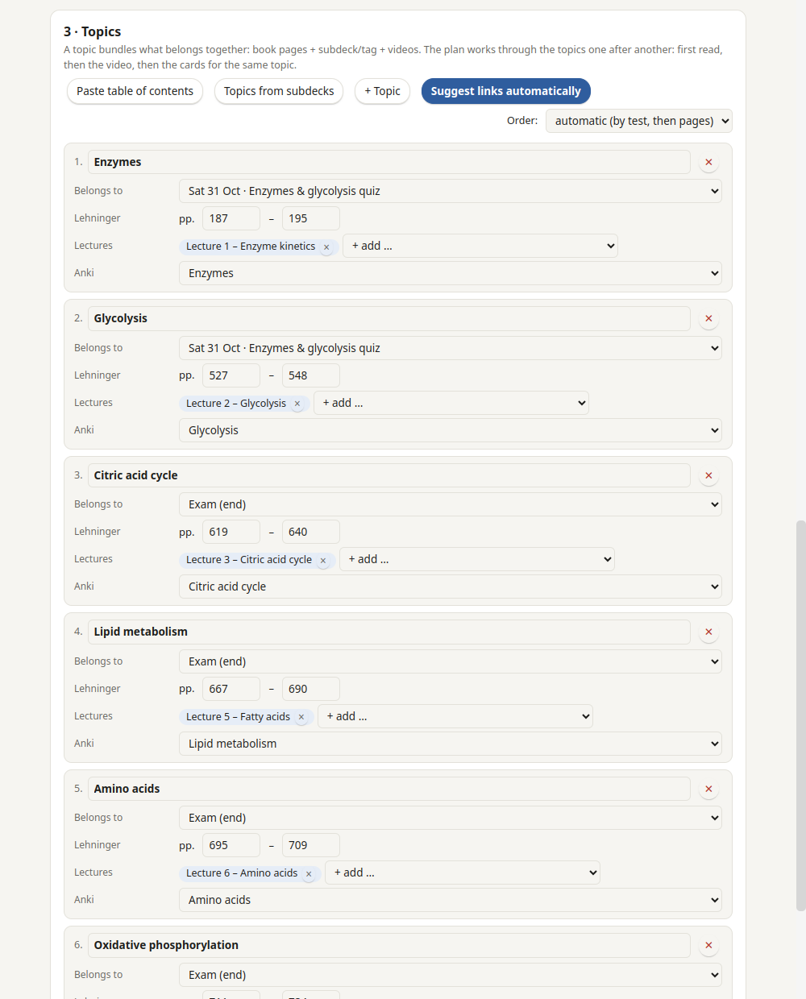 | 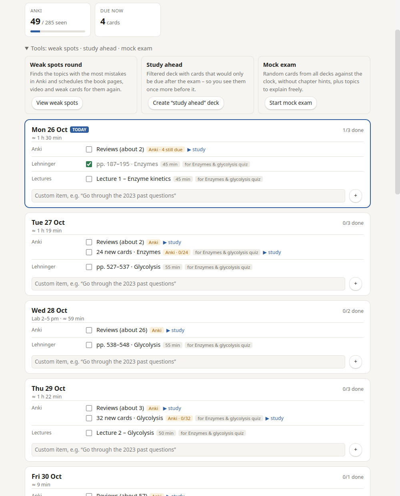 |

**Retrospective**: what worked, and your real pace for the next plan

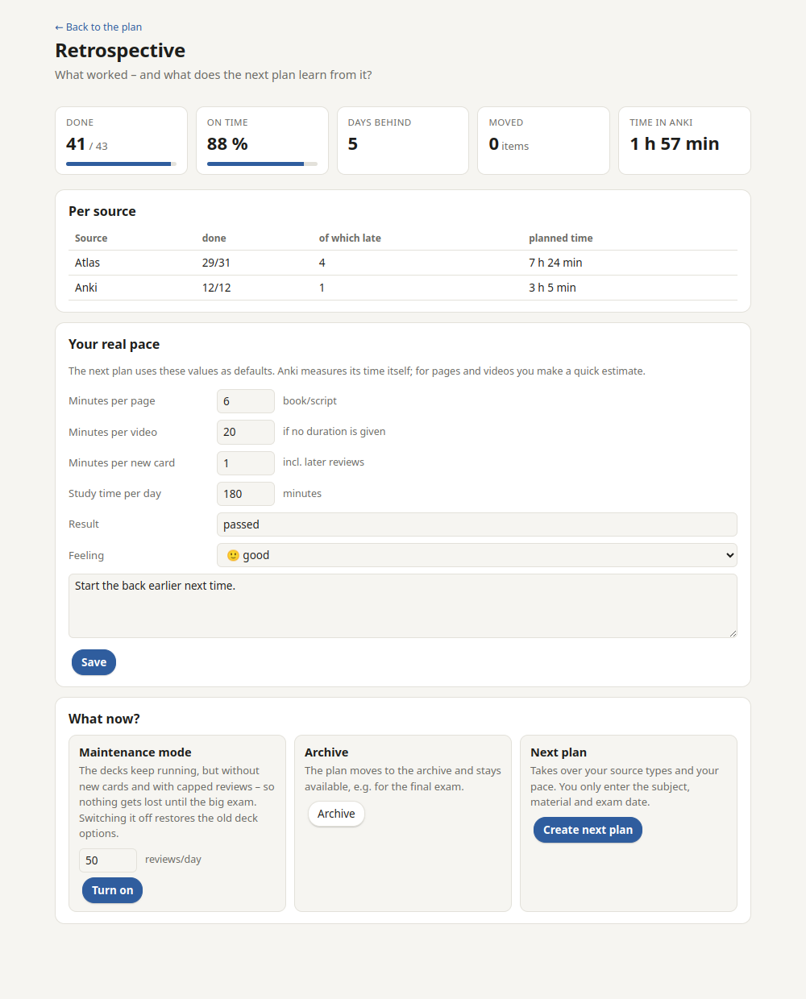

**Workspace**: notebook with PDF viewer, mind maps, AI assistant and website sidebar, all next to your Anki cards

| Notebook with PDF viewer | Mind maps |
|---|---|
| 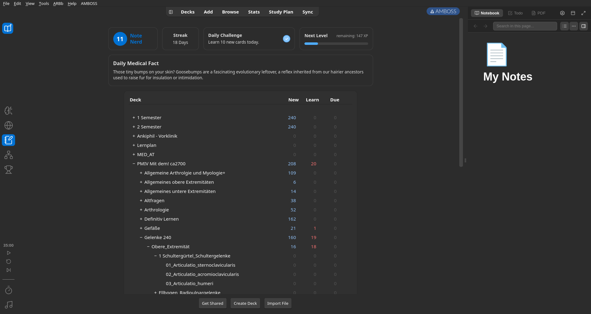 | 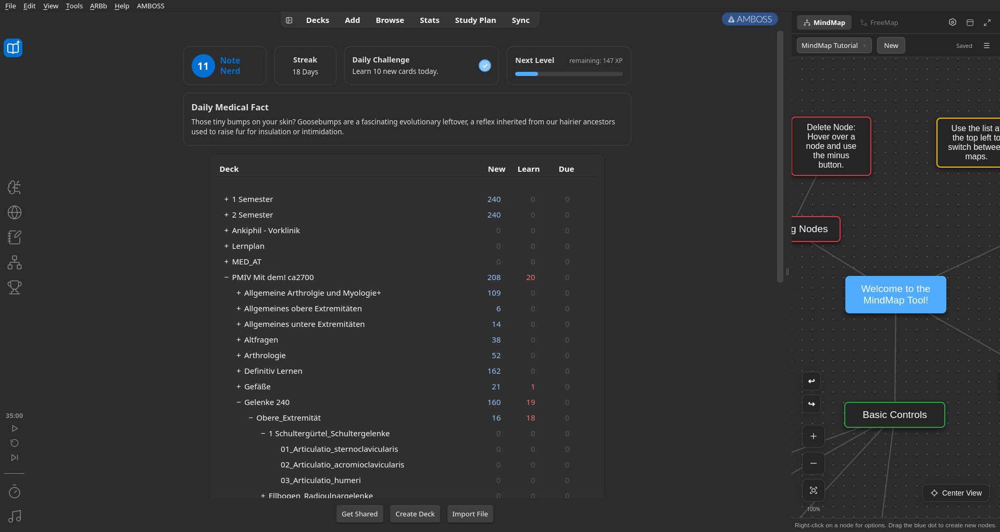 |

| AI assistant | Website sidebar (DuckDuckGo) |
|---|---|
| 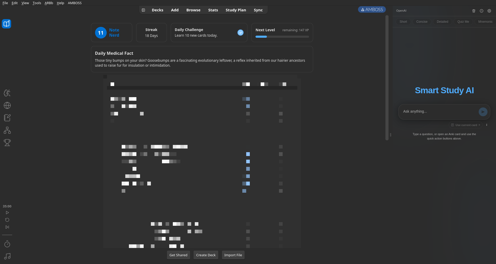 | 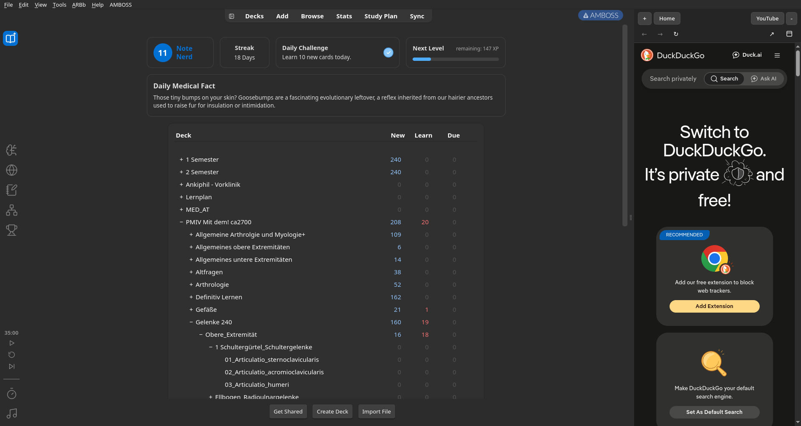 |

**Study plan window**: all your plans, streak and activity at a glance

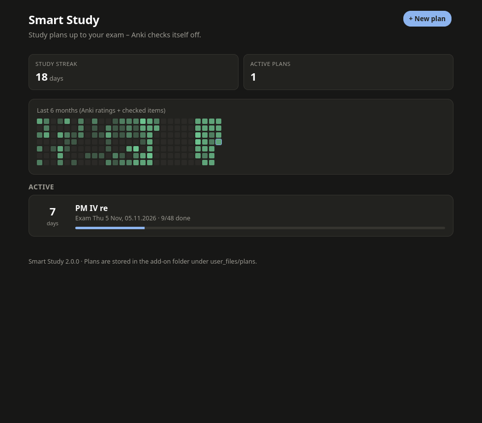

## Install

Smart Study needs Anki Desktop 25.09.4 or newer (developed and tested on 26.09).

https://ankiweb.net/shared/info/1726163334

**From a release**: download `smart_study.ankiaddon` from the [latest release](https://github.com/TruckDrive/smart-study/releases/latest) and open it with Anki (or *Tools → Add-ons → Install from file…*), then restart Anki.

**From source**:
```sh
git clone https://github.com/TruckDrive/smart-study.git
ln -s "$PWD/smart-study/addon" ~/.local/share/Anki2/addons21/smart_study   # Linux; on macOS/Windows copy the folder
```

**Updating from an older version** (0.x): uninstall it first, otherwise Anki shows two **Study Plan** links. Your plans come back by themselves through the Anki collection.

## Usage

1. Open the planner via **Tools → Smart Study → Study Plan…** or the **Study Plan** link in Anki's top bar.
2. **+ New plan**: name and exam date (you can leave the date empty for a draft).
3. **Basics**: study time per day, days off, milestones, single days (e.g. 0 minutes on a busy day).
4. **Sources**: add your book (pace in minutes per page, optional PDF), your lectures (one per line: `Name | 25 | https://…`), lists and Anki decks (search, or pick from the suggestions matching your plan name).
5. **Topics**: paste the table of contents (`Peritoneum ...... 78`) or create topics from subdecks, then **Suggest links automatically** and check the ★ suggestions.
6. **Create plan**. From then on, study in Anki as usual; the plan keeps up.
7. The workspace tools are on the launcher bar on the left; settings are under **Tools → Smart Study → Settings…**.

Plans are stored as JSON under `plan/user_files/plans/` in the add-on folder and also in your Anki collection, so **AnkiWeb sync brings them to your other devices**. If you change a plan on two devices without syncing in between, the newer copy wins.

## Privacy

Smart Study sends nothing on its own: no analytics, no remote banner, no update pings. Online connections happen only when you use a feature that needs them: the AI assistant (to the provider or website you picked), the website sidebar, SoundCloud, YouTube Music, or a link you click. Details: [PRIVACY.md](PRIVACY.md).

## Development

```sh
python -I tests/test_planner.py               # scheduler, no Anki needed
python -I tests/test_ankidata.py <empty dir>  # Anki queries on a throwaway collection
python -I tests/test_store.py <empty dir>     # plan sync between two devices
./build.sh                                     # → dist/smart_study.ankiaddon
```

- `addon/__init__.py`: entry point, menu, launcher, dashboard and hooks
- `addon/plan/`: the study planner (`planner.py` scheduler in plain Python, `ankidata.py` collection queries, `store.py` storage and sync, `web/` interface)
- `addon/*.py`, `addon/web_*`, `addon/settings_web/`: the workspace tools

## License

[GNU AGPL v3](LICENSE).

### Credits for the built-in add-ons

All bundled add-ons are licensed under the GNU AGPL v3 and were modified for Smart Study (config storage, loading as part of Smart Study, and for Contanki the controller detection). Their license files are kept in `addon/integrations/<name>/`.

- Based on the Anki add-on [Review Heatmap](https://github.com/glutanimate/review-heatmap/) by Glutanimate. [Click here to support Glutanimate's work.](https://glutanimate.com/support-my-work/)
- Controller support: based on [Contanki](https://github.com/roxgib/anki-contanki) by Sam Bradshaw
- Life Drain: based on [Life Drain](https://github.com/Yutsuten/anki-lifedrain) by Yutsuten

Parts of the workspace code are used under the MIT License; that notice is kept in [`addon/LICENSE-MIT.txt`](addon/LICENSE-MIT.txt). Bundled third-party libraries are listed in [`addon/THIRD_PARTY_NOTICES.md`](addon/THIRD_PARTY_NOTICES.md). The Lucide icons are under the ISC License (`addon/web_roadmap/icons/LICENSE.txt`).
